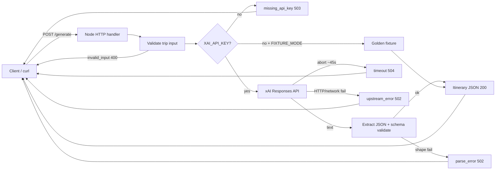

# Architecture

One vertical slice: HTTP → prompt + xAI → parse/validate → JSON or typed error.

## Notes

- **Timeout**: `GENERATE_TIMEOUT_MS` (default `45000`) aborts the upstream fetch so the client gets `timeout` instead of hanging.
- **Limits**: system prompt asks for short sentences to keep latency predictable (see `src/prompt.ts`).
- **No auth / DB / UI** in this slice — intentional for screening scope.
